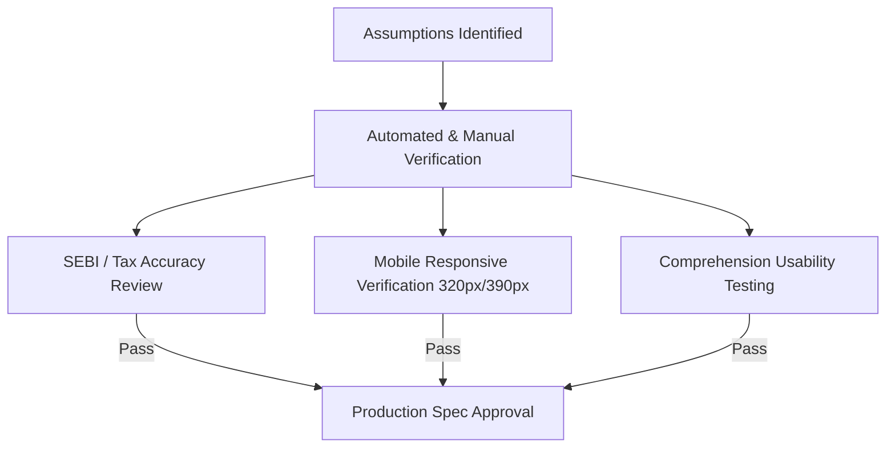

# Groww Compass — Assumptions Register & Validation Matrix

**Version:** 1.0.0  
**Document Owner:** Senior Product Engineer & Mobile-First UX Lead  

---

## 1. Executive Summary

This document captures all structural, behavioral, domain/regulatory, technical, and ecosystem assumptions underlying the **Groww Compass** prototype. Each assumption is accompanied by its rationale, confidence level, failure indicators, and explicit validation methods.

---

## 2. Comprehensive Assumptions Register

### Category 1: User & Behavioral Assumptions (Gen Z & Young Adults, 20–26)

| ID | Assumption | Rationale | Confidence | Failure Signal | Validation Method |
| :--- | :--- | :--- | :--- | :--- | :--- |
| **A-USR-01** | **Jargon Fatigue:** First-time young investors abandon investment apps when confronted with uncontextualized financial acronyms (TER, NAV, Beta, AUM). | User interviews across Indian fintech indicate Gen Z feels intimidated by Wall Street / Dalal Street vocabulary. | High (85%) | High drop-off at comparison screens; low term tap rate if terms aren't prominent. | Track drawer open rates on highlighted terms; conduct usability tests with 5 college students / freshers. |
| **A-USR-02** | **Analogy Preference:** Analogies (e.g., *"Expense ratio is like a maintenance charge on a rented flat"*) accelerate comprehension faster than mathematical formulas. | Abstract finance concepts become concrete when mapped to everyday Indian urban experiences. | High (90%) | User feedback indicating definitions remain confusing. | A/B testing definition cards: pure definition vs. definition + analogy. |
| **A-USR-03** | **Mobile-First Ergonomics:** Gen Z explores financial apps predominantly on smartphones (iPhone / Android) during transit or leisure, making thumb-zone accessibility vital. | >90% of retail retail investor traffic in India operates via mobile apps rather than desktop browsers. | Very High (95%) | User complaints about unreachable buttons or cramped tap targets. | Usability testing on 320px and 390px physical devices; automated Playwright touch-target verification. |
| **A-USR-04** | **No Desire for Wall-of-Text Blogs:** Users prefer concise, modular, card-based comparisons over 2,000-word educational articles. | Attention spans for instructional content are under 2 minutes for initial discovery. | High (85%) | High bounce rate within 15 seconds if long paragraphs are shown. | Measure time-on-screen and accordion interaction depth. |

---

### Category 2: Domain & Regulatory Assumptions (Indian Financial Context)

| ID | Assumption | Rationale | Confidence | Failure Signal | Validation Method |
| :--- | :--- | :--- | :--- | :--- | :--- |
| **A-REG-01** | **SEBI Mutual Fund Categorization:** Mutual funds in India strictly follow SEBI circular categorization (Equity, Debt, Hybrid, Solution Oriented, Other Schemes like Index/ETFs). | SEBI guidelines mandate clear boundaries for Large Cap, Mid Cap, Index replication, and Debt maturities. | Very High (99%) | Regulatory critique of asset class definitions. | Cross-check definitions against SEBI Master Circular on Mutual Funds (2024 update). |
| **A-REG-02** | **Indian Taxation Nuance (Equity vs Debt):** Equity LTCG is taxed at 12.5% above ₹1.25 Lakh (Budget 2024 update), while Debt Mutual Funds post-April 2023 are taxed at income slab rates without indexation. | Indian investors must understand that Debt funds no longer carry indexation benefits, fundamentally altering the FD vs Debt fund comparison. | Very High (95%) | Outdated tax information misleading users. | Review tax notes with qualified Indian Chartered Accountant / Tax guidelines; cite Budget 2024. |
| **A-REG-03** | **Expense Ratio Regulatory Caps:** Total Expense Ratio (TER) is legally capped by SEBI based on AMC AUM slabs (up to 2.25% for equity funds, lower for index funds). | Prevents misleading users into thinking equity fund fees are arbitrary. | High (90%) | Inaccurate fee range representations. | Explicitly note typical industry ranges (0.1–0.4% for Index, 1.0–2.2% for Active Equity). |
| **A-REG-04** | **General Education Exemption:** As long as Compass does not recommend specific securities or claim suitability for an individual, it complies with SEBI RA (Research Analyst) / RIA (Investment Adviser) regulations. | Educational discovery tools that compare asset classes structurally do not constitute personalized investment advice. | Very High (95%) | Misinterpreted as investment advisory or tips. | Prominently display persistent educational disclaimers across all comparison screens. |

---

### Category 3: Technical & Architectural Assumptions

| ID | Assumption | Rationale | Confidence | Failure Signal | Validation Method |
| :--- | :--- | :--- | :--- | :--- | :--- |
| **A-TECH-01** | **Vite + React SPA Architecture:** A client-side Single Page Application (SPA) with React 18/19 and Vite provides sub-second screen transitions and effortless offline capabilities. | Educational browsing benefits from instantaneous tab switching without server latency. | Very High (95%) | Slow initial load or routing lag. | Lighthouse performance audit; Vitest bundle analysis (<200KB). |
| **A-TECH-02** | **LocalStorage for Client Persistence:** `localStorage` is sufficient for saving non-sensitive comparison bookmarks and theme preferences without requiring backend databases or user authentication. | Zero sensitive financial data is stored; bookmarks are small JSON payloads (<50KB). | Very High (95%) | Data loss upon cache clearing in private browsing. | Implement defensive fallback (in-memory state if `localStorage` throws or is quota-exceeded). |
| **A-TECH-03** | **CSS Safe-Area Insets on Mobile:** Using Tailwind with `env(safe-area-inset-bottom)` reliably protects navigation items from iPhone home indicator overlap. | Standard modern mobile web best practice. | High (90%) | Bottom navigation buttons overlapped by home swipe bar on iOS. | Responsive testing in Safari iOS simulator / physical iPhone. |

---

### Category 4: Groww Ecosystem Overlap & Boundary Assumptions

| ID | Assumption | Current Groww Baseline & Validation Need | Boundary in Compass Prototype |
| :--- | :--- | :--- | :--- |
| **A-ECO-01** | **Scheme vs. Category Gap:** Groww's existing app is optimized for searching and investing in **specific schemes** (e.g. *Nippon India Small Cap Fund*, *Tata Digital India Fund*), but does not have a dedicated pre-investment **structural comparison lab** between asset categories. | **Assumption to validate:** Groww may already have educational articles or glossary cards embedded in certain product pages. We do not claim Groww lacks educational content; we hypothesize that a side-by-side dimensional tool reduces onboarding friction. | Compass remains strictly at the **asset class** level. It hands off to Groww's verified scheme explorer. |
| **A-ECO-02** | **Deep Linking Hand-off:** Groww mobile app and web portal support category-level routing (e.g., `/mutual-funds/index-funds`, `/stocks`). | **Assumption to validate:** Deep link URL structures for Groww web and mobile app schemes. | Compass uses honest placeholder links with explicit prototype transition modals to avoid broken external navigation. |
| **A-ECO-03** | **Brand Respect & Non-Affiliation:** Prototype should evoke modern Indian fintech aesthetics (emerald green `#00D09C`, calm dark mode) without copying proprietary Groww UI code, icons, or trademarks. | Protect intellectual property while providing a high-fidelity case study experience. | Use open-source Lucide icons, custom Tailwind tokens, and explicit case-study attribution. |

---

## 3. Assumptions Validation & Risk Mitigation Plan

1. **Taxation & Regulatory Verification:**
   - Verify all tax figures cited in the comparison engine reflect Budget 2024 changes (LTCG ₹1.25L exemption, 12.5% rate for equity, no indexation for debt).
2. **Device Width Verification:**
   - Automated viewport tests run at 320px (iPhone SE 1st gen), 375px (iPhone SE 2nd gen), 390px (iPhone 14/15/16), and 414px (Plus/Max models) to ensure zero horizontal scrolling.
3. **Ecosystem Boundary Guardrails:**
   - Every external CTA displays a clear prototype modal: *"Prototype handoff — in a live environment, this deep-links to the verified Groww category explorer."*
